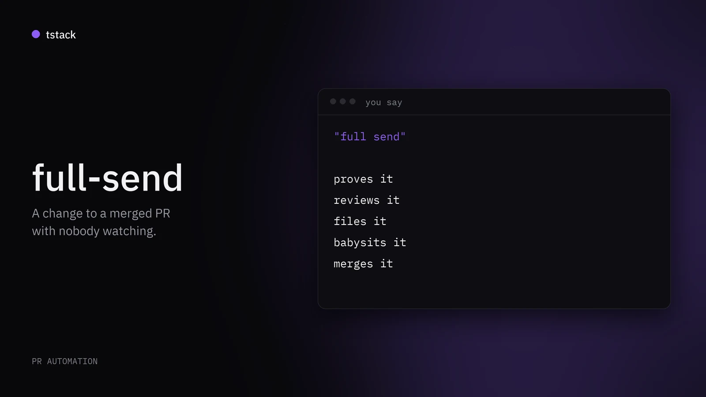
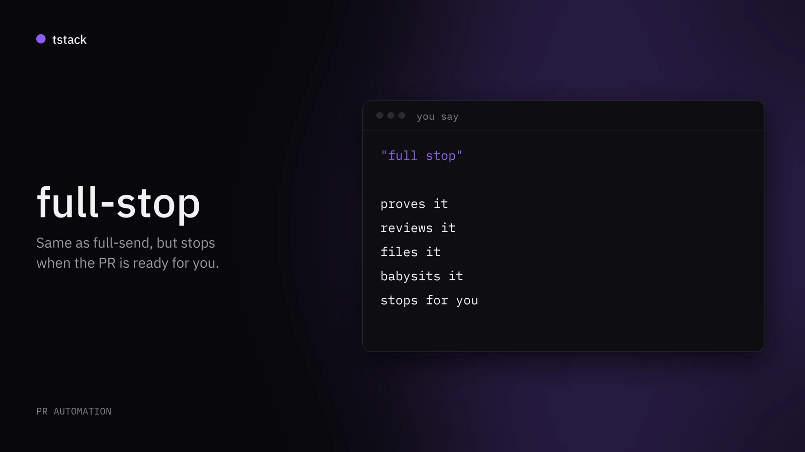
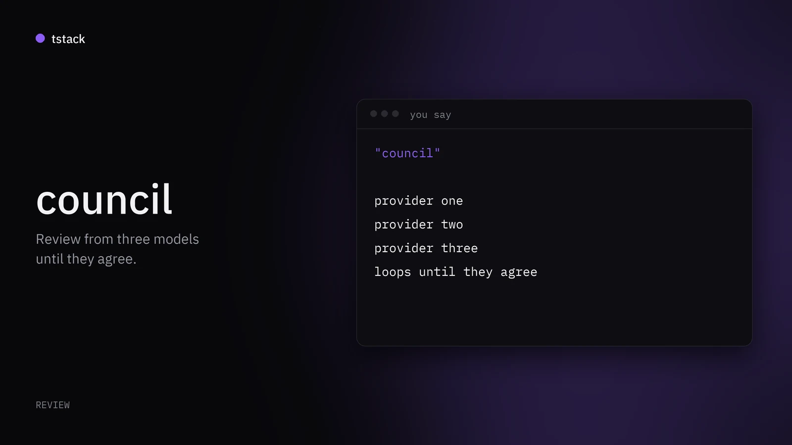
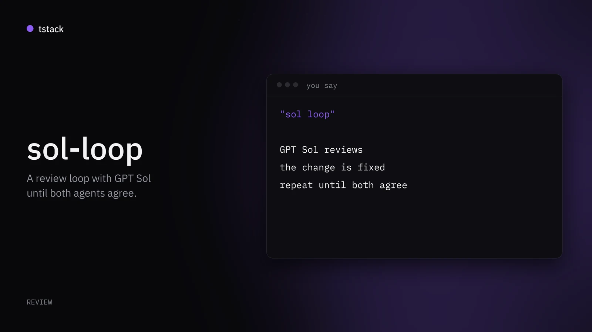
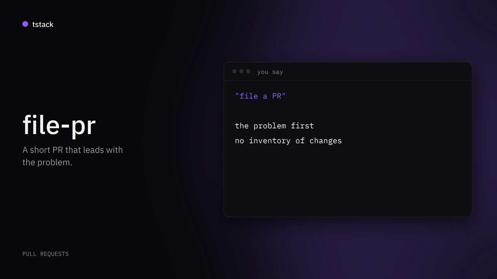
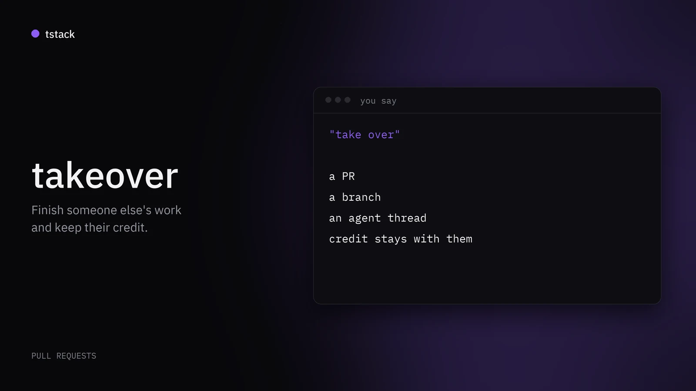
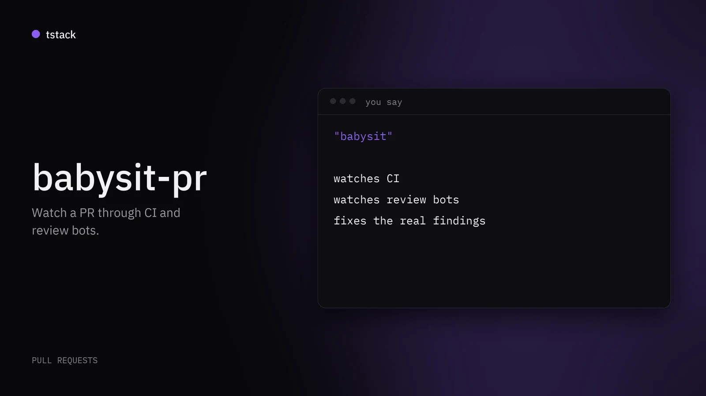
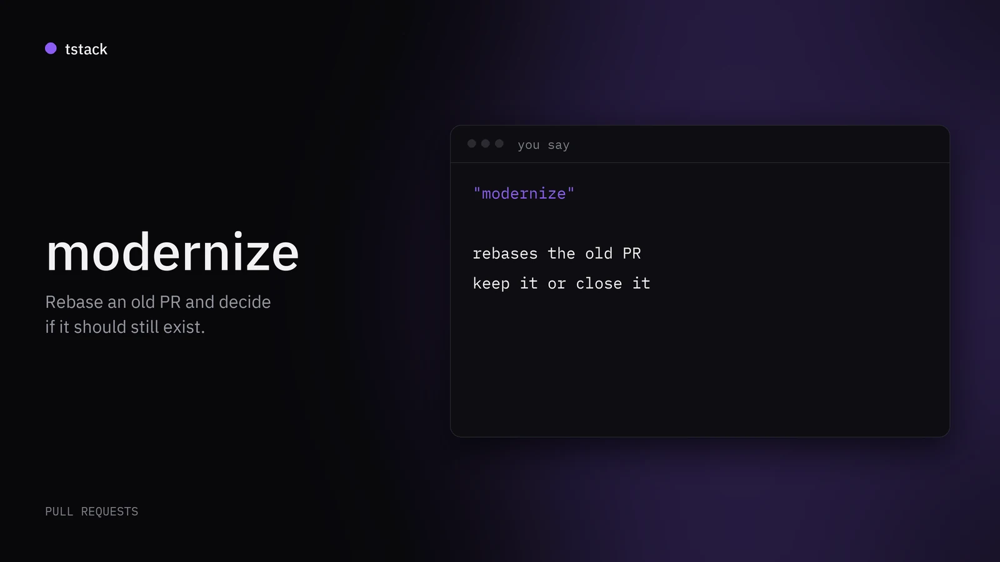

<div align="center">


# tstack

**The agent skills I use every day, cleaned up so anyone can use them. They work in Claude Code and Codex.**

<a id="gallery"></a>

<table>
<tr>
<td width="50%" valign="top">
<a href="#full-send"></a>
<br/><a href="#full-send"><strong>full-send</strong></a>
<br/><sub>PR automation, say &quot;full send&quot;</sub>
</td>
<td width="50%" valign="top">
<a href="#full-stop"></a>
<br/><a href="#full-stop"><strong>full-stop</strong></a>
<br/><sub>PR automation, say &quot;full stop&quot;</sub>
</td>
</tr>
<tr>
<td width="50%" valign="top">
<a href="#council"></a>
<br/><a href="#council"><strong>council</strong></a>
<br/><sub>Review, say &quot;council&quot;</sub>
</td>
<td width="50%" valign="top">
<a href="#sol-loop"></a>
<br/><a href="#sol-loop"><strong>sol-loop</strong></a>
<br/><sub>Review, say &quot;sol loop&quot;</sub>
</td>
</tr>
<tr>
<td width="50%" valign="top">
<a href="#file-pr"></a>
<br/><a href="#file-pr"><strong>file-pr</strong></a>
<br/><sub>Pull requests, say &quot;file a PR&quot;</sub>
</td>
<td width="50%" valign="top">
<a href="#takeover"></a>
<br/><a href="#takeover"><strong>takeover</strong></a>
<br/><sub>Pull requests, say &quot;take over&quot;</sub>
</td>
</tr>
<tr>
<td width="50%" valign="top">
<a href="#babysit-pr"></a>
<br/><a href="#babysit-pr"><strong>babysit-pr</strong></a>
<br/><sub>Pull requests, say &quot;babysit&quot;</sub>
</td>
<td width="50%" valign="top">
<a href="#modernize"></a>
<br/><a href="#modernize"><strong>modernize</strong></a>
<br/><sub>Pull requests, say &quot;modernize&quot;</sub>
</td>
</tr>
</table>

[](./LICENSE)
[](#skills)
[](https://github.com/t3dotgg/tstack)
[](#install)

</div>

> This is a fork of [t3dotgg/tstack](https://github.com/t3dotgg/tstack). The skills and the words on this page are upstream's; only the page layout is new here.

---

## Table of contents

| Automate | Review and PRs | Get it |
|---|---|---|
| [`full-send`](#full-send)<br>[`full-stop`](#full-stop) | [`council`](#council)<br>[`sol-loop`](#sol-loop)<br>[`file-pr`](#file-pr)<br>[`takeover`](#takeover)<br>[`babysit-pr`](#babysit-pr)<br>[`modernize`](#modernize) | [Install](#install)<br>[Requirements](#requirements)<br>[Make them yours](#make-them-yours)<br>[License](#license) |

---

## Skills

Some use [T3 Code](https://github.com/pingdotgg/t3code) features when they are available and fall back to native tools when they are not.

`leaving-pr-comments` runs automatically: it formats comments that an agent posts on your behalf.

<a id="full-send"></a>

### [`full-send`](./skills/full-send)


**Category:** PR automation
**Say:** "full send"

Takes a change to a merged PR with nobody watching: proves it, reviews it, files it, babysits it, merges it.

Uses `sol-loop`, `file-pr`, and `babysit-pr`.

Links: [SKILL.md](./skills/full-send/SKILL.md)

---

<a id="full-stop"></a>

### [`full-stop`](./skills/full-stop)


**Category:** PR automation
**Say:** "full stop"

Same as `full-send`, but stops when the PR is ready for you to merge.

Uses `full-send`.

Links: [SKILL.md](./skills/full-stop/SKILL.md)

---

<a id="council"></a>

### [`council`](./skills/council)


**Category:** Review
**Say:** "council"

Gets review from three models from different providers, and loops until they agree.

Needs subagents on other providers' models.

Links: [SKILL.md](./skills/council/SKILL.md)

---

<a id="sol-loop"></a>

### [`sol-loop`](./skills/sol-loop)


**Category:** Review
**Say:** "sol loop"

Reviews a change with GPT Sol in a loop until both agents agree.

Needs subagents on other providers' models.

Links: [SKILL.md](./skills/sol-loop/SKILL.md)

---

<a id="file-pr"></a>

### [`file-pr`](./skills/file-pr)


**Category:** Pull requests
**Say:** "file a PR"

Files a short PR that leads with the problem, not an inventory of changes.

Uses `leaving-pr-comments`.

Links: [SKILL.md](./skills/file-pr/SKILL.md)

---

<a id="takeover"></a>

### [`takeover`](./skills/takeover)


**Category:** Pull requests
**Say:** "take over"

Finishes someone else's PR, branch, or agent thread, and keeps their credit.

Uses `modernize`, `file-pr`, `babysit-pr`, and `leaving-pr-comments`.

Links: [SKILL.md](./skills/takeover/SKILL.md)

---

<a id="babysit-pr"></a>

### [`babysit-pr`](./skills/babysit-pr)


**Category:** Pull requests
**Say:** "babysit"

Watches a PR through CI and review bots, and fixes the real findings.

Uses `leaving-pr-comments`. Needs `python3` for its `pr-wait` script.

Links: [SKILL.md](./skills/babysit-pr/SKILL.md)

---

<a id="modernize"></a>

### [`modernize`](./skills/modernize)


**Category:** Pull requests
**Say:** "modernize"

Rebases an old PR and decides if it should still exist.

Uses `leaving-pr-comments`.

Links: [SKILL.md](./skills/modernize/SKILL.md)

---

## Install

```bash
git clone https://github.com/t3dotgg/tstack
cp -R tstack/skills/* ~/.claude/skills/   # Claude Code
cp -R tstack/skills/* ~/.codex/skills/    # Codex
```

## Requirements

- An authenticated [GitHub CLI](https://cli.github.com) (`gh`).
- `python3` for `babysit-pr`'s `pr-wait` script.
- `council` and `sol-loop` need subagents on other providers' models. T3 Code
  does this with `delegate_task`. Otherwise you need a harness that can run
  those models.

## Make them yours

These are starting points. Edit them. Put personal settings, like which models
sit on your council, in your `CLAUDE.md` or `AGENTS.md`, so you can update the
skills without losing them.

## License

[MIT](LICENSE)
